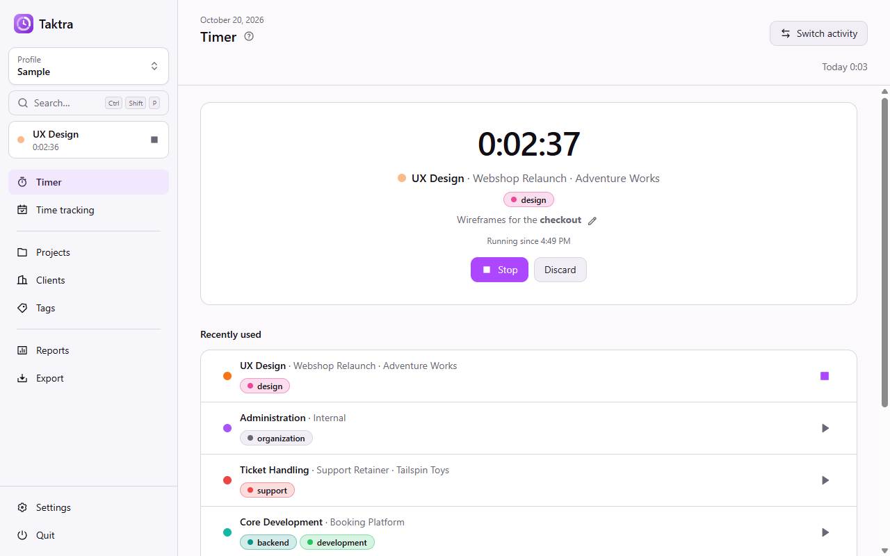
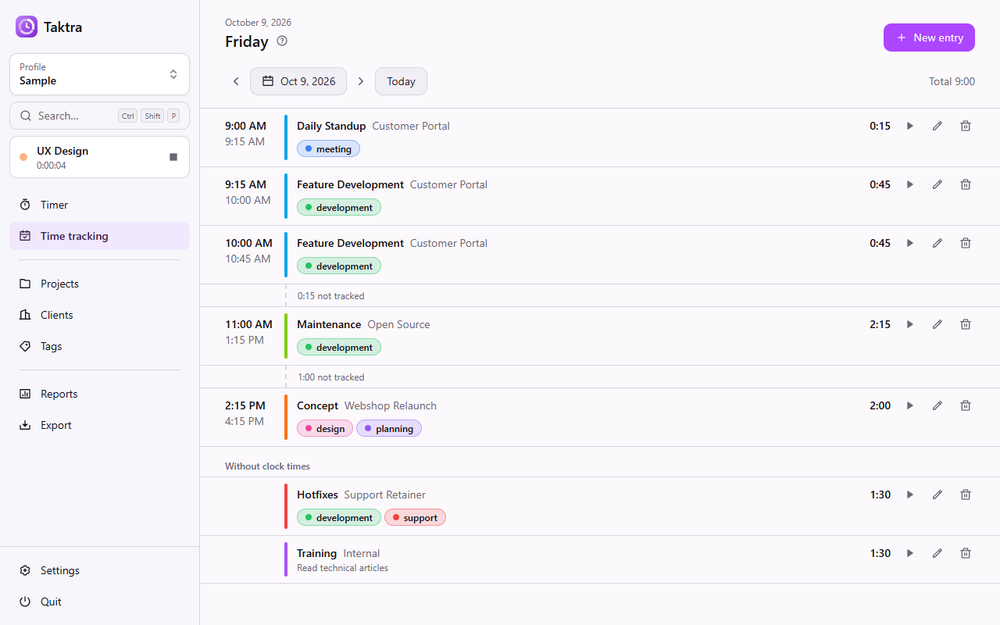
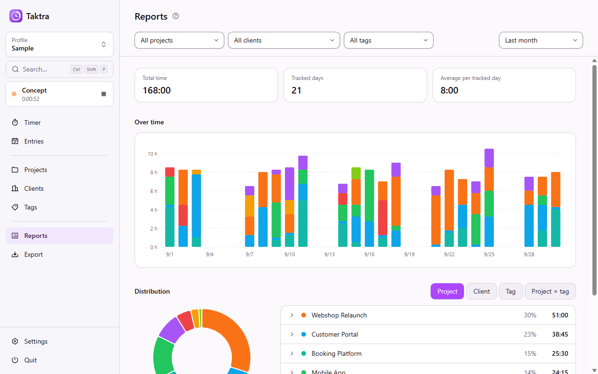
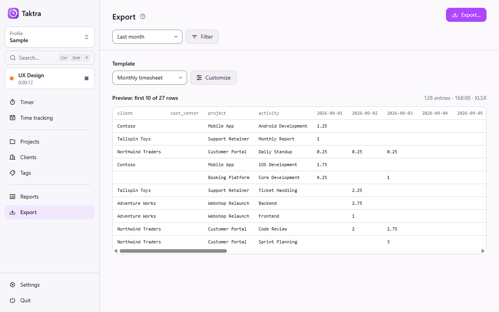
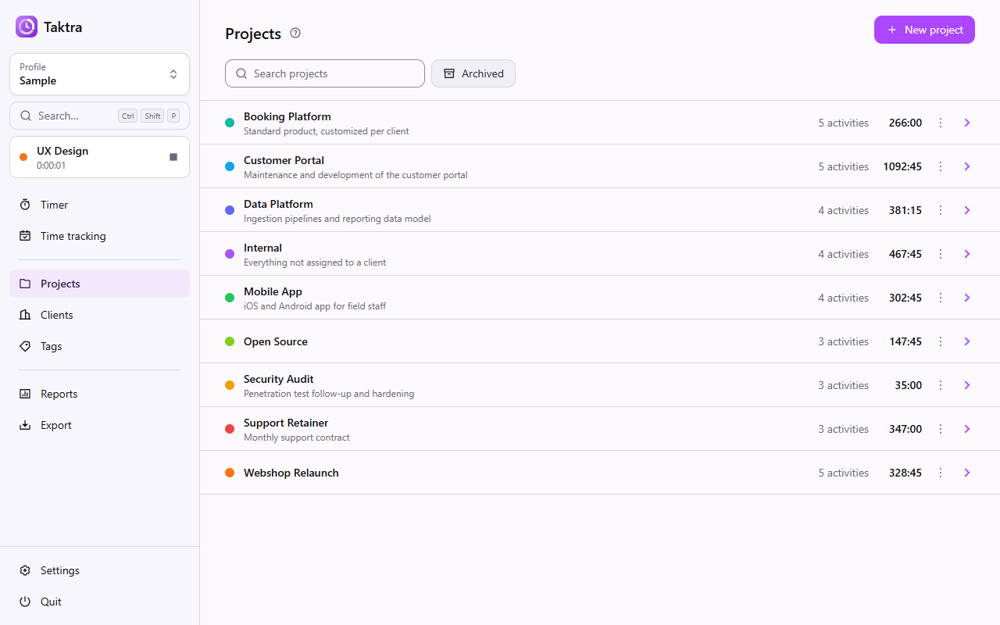
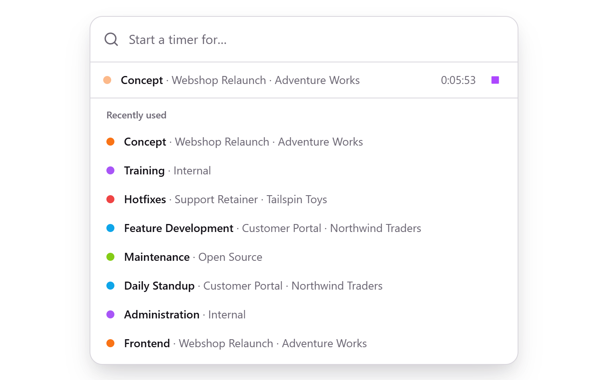
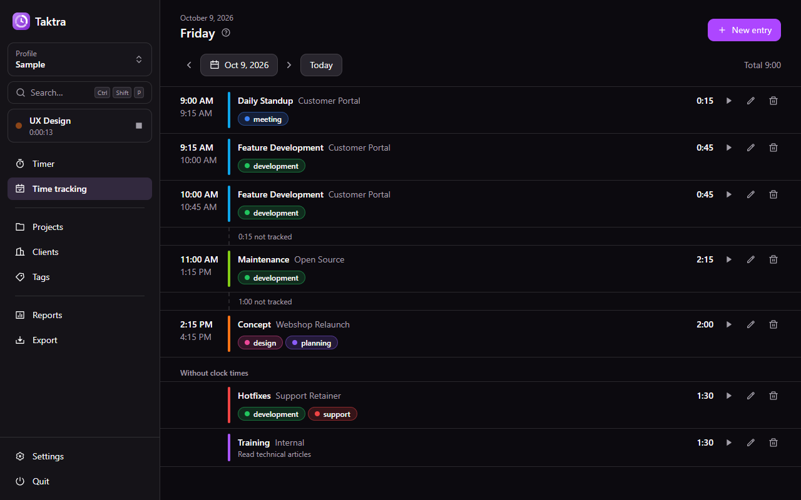

<p align="center">
  
  <h1 align="center">Taktra</h1>
</p>
<p align="center">
  Local time tracking without the overhead.
</p>
<p align="center">
  
  
  
  
  
</p>
<p align="center">
  
</p>

## Table of Contents

- [Introduction](#introduction)
- [Features](#features)
- [Screenshots](#screenshots)
- [Download](#download)
- [Motivation](#motivation)
- [Development](#development)
  - [Database Migrations](#database-migrations)
  - [Checks](#checks)
- [Build](#build)
  - [Release](#release)
- [License](#license)
  - [Forbidden](#forbidden)

## Introduction

Taktra is a local-first time tracker for the desktop. Install it, start a timer, and you are done: there is
no server to run, no account to create and no cloud that holds your data. Everything happens on your
machine, and your data is a plain file you own.

- **Your data, your file.** Each profile is a single `*.taktra` file wherever you keep it. Backing it up or
  moving it is as simple as copying a document.
- **Works offline, always.** No server, no account, no telemetry. The only network access is the optional
  update check, which can be turned off.
- **A timer one click away.** From the start page, the tray icon or a global shortcut.
- **Lean by design.** It starts instantly, lives quietly in the tray and does one thing well.

## Features

- Projects, activities and tags; recurring work is simply the same activity booked again
- Clients to see who the work is for
- Time entries with start and end, as a plain duration or by a start/stop timer, with Markdown notes
- Quick start from the tray or a global shortcut, and an always-on-top mini timer
- Reports by project, client and tag over any period
- Custom fields on projects, clients and activities, e.g. an order number or a cost center
- Export to CSV, JSON or Excel in a stable format for billing and other tools, with templates for
  the columns and for sums per day, also with the days as columns like a time sheet
- Several profiles, each in its own file, like KeePass databases
- Light and dark theme, English and German, command palette and keyboard shortcuts
- An in-app help that explains the concepts in short chapters

## Screenshots

<table>
  <tr>
    <td width="33%"><a href="./docs/screenshots/entries.png"></a></td>
    <td width="33%"><a href="./docs/screenshots/reports.png"></a></td>
    <td width="33%"><a href="./docs/screenshots/export.png"></a></td>
  </tr>
  <tr>
    <td width="33%"><a href="./docs/screenshots/projects.png"></a></td>
    <td width="33%"><a href="./docs/screenshots/quick-start.png"></a></td>
    <td width="33%"><a href="./docs/screenshots/entries-dark.png"></a></td>
  </tr>
</table>

Screenshots show the generated sample profile.

## Download

Taktra is available for Windows so far. The [latest release](https://github.com/MuellerConstantin/taktra/releases/latest)
offers two packages:

- **Installer** (`taktra-<version>-setup.exe`): installs per user without admin rights and keeps itself up
  to date.
- **Portable zip** (`taktra-<version>-portable.zip`): runs without installation. It does not update
  itself but points to new releases.

The welcome screen offers a sample profile to look around before booking your own time.

## Motivation

I built Taktra for my own work. I needed to keep track of how my time is split across projects and
recurring tasks, and the tools I looked at were either hosted services that hold my data or self-hosted
platforms that require running and maintaining a server, a database and user accounts — far too much
overhead for one person who just wants to book a few hours a day.

What I wanted was something lean: an app that starts instantly, works offline, and keeps everything in a
single local file that I can back up or move myself. Taktra is exactly that and deliberately not more — no
server to run, no account, no BI tool, just booking time and seeing where it went.

## Development

The development environment needs nothing besides Node.js. `better-sqlite3` ships prebuilt binaries for
Windows, macOS and Linux, so no compiler toolchain is required.

Requirements:

- Node.js 24+ and NPM

Installs the dependencies, including Electron itself.

```bash
npm install
```

Starts the app in development mode with hot reload for the renderer.

```bash
npm run dev
```

Profiles and settings are stored in the user data directory — `%APPDATA%\taktra` on Windows,
`~/Library/Application Support/taktra` on macOS, `~/.config/taktra` on Linux. The sample profile on the
welcome screen is the quickest way to get realistic data for development.

### Database Migrations

The schema lives in `src/main/db/schema/`. After changing it, generate a migration and commit it together
with the schema change. Generated migrations are never edited by hand.

```bash
npm run db:generate -- --name <what_changed>
```

### Checks

Type checking, linting and formatting must pass before a change is done. CI runs them on every push and
pull request.

```bash
npm run typecheck
npm run lint
npm run format
```

## Build

Packaging is configured for Windows so far. The build runs the type check, bundles the app with
electron-vite and creates two packages in `dist/`: an installer (`taktra-<version>-setup.exe`) that
installs per user without admin rights and lets you choose the folder, and a portable zip
(`taktra-<version>-portable.zip`) that runs without installation.

```bash
npm run build:windows
```

`npm run build:unpack` builds an unpacked app directory instead, which is handy for a quick test of the
production build.

### Release

Releases are built by GitHub Actions. Pushing a tag `v<version>` that matches the version in
`package.json` builds both packages on Windows and creates a draft GitHub release. Its notes are taken
from the matching section in `CHANGELOG.md`, so that section has to exist before tagging. The draft is
only visible once it is published by hand.

1. In `CHANGELOG.md`, rename `## [Unreleased]` to `## [<version>] - <date>` and add a new empty
   `## [Unreleased]` above it.
2. Commit, tag and push.

   ```bash
   git tag v<version>
   git push origin main v<version>
   ```

3. Check the draft release on GitHub and publish it.

Running the release workflow manually rehearses the same steps from the `[Unreleased]` section without
creating a release; the packages are kept as workflow artifacts.

## License

Copyright (c) 2026 Constantin Müller

[GNU AFFERO GENERAL PUBLIC LICENSE](https://www.gnu.org/licenses/) or [LICENSE](./LICENSE.md) for
more details.

### Forbidden

**Hold Liable**: Software is provided without warranty and the software
author/license owner cannot be held liable for damages.
